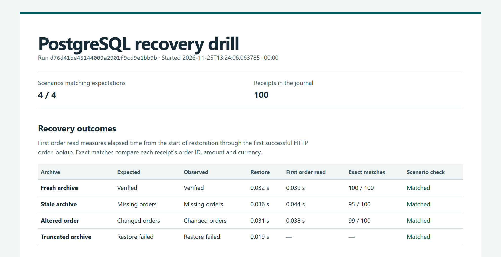

# PostgreSQL Recovery Drill

Would a shop get all its orders back after a restore? This lab accepts 100 orders over HTTP, takes real PostgreSQL backups, restores them into empty databases and checks every recovered order against a separate receipt journal. One archive restores cleanly and returns all 100 IDs. The amount on one recovered order is a dollar higher than the customer agreed to pay.

The recorded run used PostgreSQL 17.12 on a GitHub-hosted Ubuntu runner. The stale archive served its first verified order in 44 ms and still lacked the last five purchases. Expand **Altered order** in the downloaded HTML to inspect the amount difference. The JSON files contain the measurements and original observations from that run. [Workflow log](https://github.com/y3sh1/postgres-recovery-drill/actions/runs/45623098918/job/139236136387) · [Report JSON](examples/report.json) · [Captured rows](examples/observations.json) · [HTML report](examples/report.html)

To inspect the saved run without installing PostgreSQL or Docker, clone the repository and rerun the comparison using the Python standard library.

~~~sh
git clone https://github.com/y3sh1/postgres-recovery-drill.git
cd postgres-recovery-drill
python -m drill.verify examples
~~~

## Run the drill

Install Docker with Compose v2. From the repository root, run the commands below. The project starts its own PostgreSQL 17 server on a private Compose network. The service and database publish no host ports.

~~~sh
docker compose up --build --abort-on-container-exit --exit-code-from drill
docker compose cp drill:/reports/. ./artifacts
docker compose down --volumes
~~~

Open **artifacts/report.html** in a browser and expand a scenario to inspect its evidence. The exit code is 0 when all four scenarios produce the expected observations, 1 for an unexpected outcome, and 2 if the drill cannot complete. A deliberately failed restore is one of the four expected observations.

The output also includes **report.json** and **observations.json**. The latter contains the original receipt rows and the rows collected from each restored database. From this checkout, verify a saved bundle offline with Python 3.11+ and its standard library.

~~~sh
python -m drill.verify artifacts
~~~

## Four archives from one set of orders

| Archive | How it is produced | What the drill should observe |
| --- | --- | --- |
| Fresh | Dump the source after order 100 | All 100 receipts match the recovered ID, amount and currency. |
| Stale | Dump the source after order 95, then accept five more | The service can read an order. Orders ORD-096 through ORD-100 are missing. |
| Altered | Clone the source, add 100 cents to ORD-042 in the clone and dump it | All 100 IDs are present. The journal says USD 25.54 and the recovered order says USD 26.54. |
| Truncated | Keep the first eight bytes of the fresh archive | PostgreSQL rejects the archive. The target contains no orders table. Readiness and order completeness remain unmeasured. |

The runner creates a fresh database for every restore. It invokes the PostgreSQL toolchain with the custom archive format and a single-transaction restore. Only databases created by this run are eligible for cleanup.

## What the clock measures

**Restore duration** begins immediately before launching the restore command and ends when the process exits. **First order read** runs from the same starting point through starting a recovery-mode HTTP service and retrieving the expected ID, amount and currency for ORD-001. Creating the target database, building the containers and comparing all 100 receipts happen outside this interval.

The stale and altered archives can both serve ORD-001. The subsequent full comparison shows which purchases would still be missing or incorrect. The fraction of exact matches uses the receipt count as its denominator. Surplus database rows appear separately.

## How the shop acknowledges a purchase

The client supplies a unique order ID and an amount in integer cents. The service commits the row to PostgreSQL, records a receipt in SQLite and then sends HTTP success. The journal lives outside the PostgreSQL archive. Repeating an accepted purchase returns its existing result. Reusing its ID with a different amount returns HTTP 409.

A crash between the two commits can leave a database row without a receipt. Retrying the same order finishes the receipt. A crash after the receipt commit can leave the client waiting for a response to a purchase the service accepted. The reference ledger therefore represents accepted purchases. The seeding step also checks every client acknowledgement.

| Endpoint | Behaviour |
| --- | --- |
| POST /orders | Accept a purchase, or replay the result for the same ID and payload. |
| GET /orders/{id} | Read the stored ID, amount and currency. |
| GET /health/ready | Check that the expected order columns can be queried. |

The restore probe uses the order endpoint. The recovery server accepts reads, uses read-only database transactions, and leaves the receipt journal closed.

## Verification

GitHub Actions builds the same Compose image, runs the tests with a real PostgreSQL server, runs the four restores and checks their evidence. The test suite covers concurrent retries, partial writes across the two stores, conflicting IDs, missing rows, replaced IDs with identical row counts, and altered amounts. The live test provisions its own short-lived database.

To run the tests through Docker:

~~~sh
docker compose build
docker compose up -d --wait db
docker compose run --rm -e SHOP_TEST_DSN=postgresql://drill@db/postgres drill python -m pytest -q -p no:cacheprovider
docker compose down --volumes
~~~

## Scope

This is a logical backup exercise with synthetic orders, a single currency and a known workload. The database and the receipt journal share one Docker host, and the lab starts a single shop process. A site-loss drill would need independently hosted receipt storage, off-host backups and a realistic failover path. The measured times describe the small dataset and machine that ran the exercise. Physical backups, WAL replay, point-in-time recovery and production recovery objectives are outside its scope.

## Credits

The service, orchestration, scenario definitions, reconciliation and evidence renderer were developed for this project. PostgreSQL supplies the backup and restore tools, Psycopg provides the database connection, SQLite stores the receipts, and Docker Compose and GitHub Actions run the lab. [PostgreSQL pg_dump](https://www.postgresql.org/docs/17/app-pgdump.html) · [PostgreSQL pg_restore](https://www.postgresql.org/docs/17/app-pgrestore.html) · [Psycopg 3](https://www.psycopg.org/psycopg3/docs/) · [SQLite transactions](https://sqlite.org/lang_transaction.html) · [Compose startup order](https://docs.docker.com/compose/how-tos/startup-order/)
